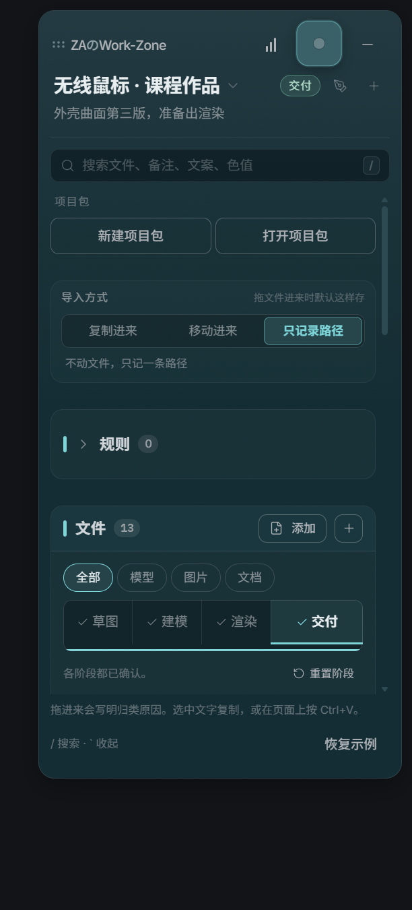
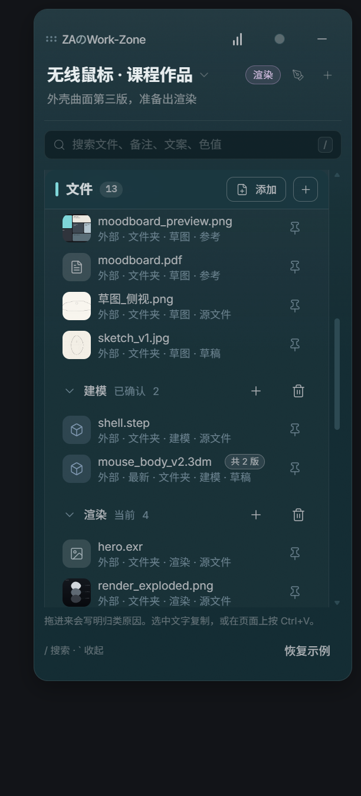

# ZAのWork-Zone

一个悬浮在桌面上的文件工作台，帮你把杂乱的工作文件自动归好类：文件拖进来按类型和文件名自动分到对应阶段，同一文件的多个版本自动识别，剪贴板里的图片保留原图、随手拖进 PPT 或邮件。适合任何需要整理项目文件的人，比如方案汇报、课程作业、设计项目（Rhino / KeyShot 等建模渲染文件也能自动识别）。

<p>
  
  
</p>

## 功能

- **文件区**：把文件拖进来，可选「复制进来 / 移动进来 / 只记录路径」，自动按类型（模型、图片、文档）分类。
- **阶段**：草图 → 建模 → 渲染 → 交付，每个阶段对应一个文件夹，逐步确认，交付时有小动画。
- **规则**：按文件名、扩展名自动归到对应阶段，并写明归类原因。
- **剪贴板历史**：记录复制过的文字和图片；图片保存原图，可以像文件一样直接拖到作业系统、PPT、聊天窗口，也能另存为或复制到当前阶段文件夹，导出文件名形如 `项目名_阶段_01.png`。
  - 磁盘控制：单张超过 8MB 只留缩略图，原图总量上限 500MB，未钉住的超过 7 天自动清理，钉住的永久保留。
  - 隐私：默认忽略密码管理器（1Password、Bitwarden）里的复制内容，并过滤疑似密钥、卡号。
- **项目包**：把整个项目打包导出 / 打开。
- 全局快捷键呼出，收起后是一个小胶囊。

## 安装

到 [Releases](../../releases) 下载 `ZA Work-Zone_x.y.z_x64-setup.exe`，双击安装即可（Windows 10/11 x64）。

## 从源码构建

需要 Node.js 22+、Rust（stable）、Visual Studio 2022 Build Tools（C++ 桌面开发）和 WebView2。也可以运行 `setup-windows.ps1` 自动检查环境。

```bash
npm install
npm run build
npx tauri build
```

安装包在 `src-tauri/target/release/bundle/nsis/`。

> ⚠️ 不要直接分发 `cargo build --release` 产出的 exe：它没有内嵌前端，会去连开发地址 `http://127.0.0.1:8080`，打开后显示 ERR_CONNECTION_REFUSED。请始终用 `npx tauri build` 生成的安装包。

开发调试：`npm run desktop:dev`。

## 数据位置

所有数据保存在本机：`%APPDATA%\studio.za.workzone\`

- `zone.db`：项目、文件、剪贴板记录
- `clips\`：剪贴板原图

## 许可证

[MIT](LICENSE) © 2026 zazie

---

## English

**ZAのWork-Zone** is a small always-on-top desktop workspace (Tauri 2 + React) that keeps messy work files sorted for you: drop files in and they are auto-sorted into project stages by type and name, file versions are detected automatically, custom rules let you tune the sorting, and clipboard history keeps images at original quality so you can drag them out like real files. It suits anyone who juggles project files (reports, coursework, design projects; Rhino / KeyShot files are recognized too).

- Install: download the `setup.exe` from Releases (Windows x64).
- Build: `npm install && npm run build && npx tauri build` (don't ship a bare `cargo build` exe; it has no embedded frontend).
- Data: `%APPDATA%\studio.za.workzone\`.
- License: MIT.
